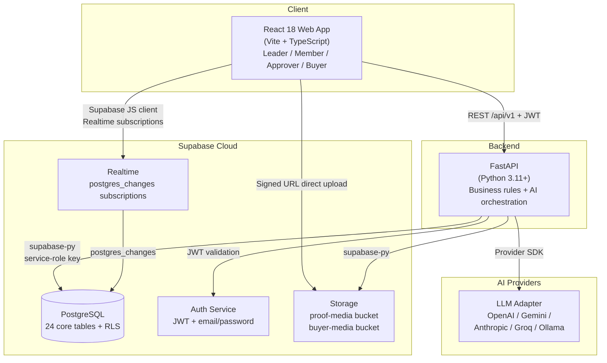
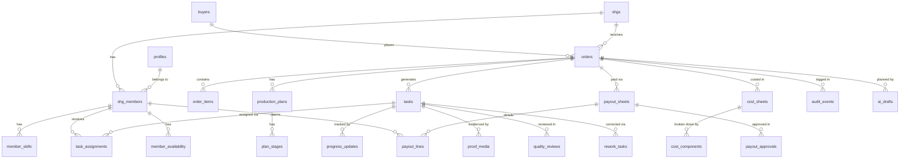

# Design Document — ASHA Platform

## Overview

ASHA (Allocation, Shares & Honest Accounts) is a voice-first, multilingual operations platform for women's self-help groups (SHGs). It replaces informal WhatsApp coordination and manual notebooks with a transparent, end-to-end production workflow that takes a bulk order from intake to group-approved, member-wise payout.

The core design principle is: **AI proposes. Rules calculate. Humans approve.**

LLMs draft plans and explanations. Deterministic Python engines calculate allocation scores, unit costs, and payout amounts. Human roles — Leader, Approver, Checker — confirm every critical step. The system is designed so that no AI output can silently alter a financial or allocation record.

This document covers the full technical design for the MVP: system architecture, database schema, service boundaries, key algorithms, frontend architecture, AI adapter, voice interface, security model, end-to-end data flows, and correctness properties for the deterministic engines.

---

## Architecture

### Component Overview

ASHA is a Turborepo + pnpm monorepo with three primary runtime components: a React web application, a FastAPI backend, and a Supabase cloud project.



### Monorepo Layout

```text
asha/
├── apps/
│   ├── web/          # React frontend
│   └── api/          # FastAPI backend
├── packages/
│   ├── shared-types/ # TypeScript types + Zod schemas for all core entities
│   ├── ui/           # Shared Chakra UI component library
│   ├── config/       # ESLint, TypeScript, Tailwind shared configs
│   └── database/     # SQL migrations, seed scripts, RLS policy files
├── turbo.json
├── pnpm-workspace.yaml
└── package.json
```

### Key Design Decisions

| Decision | Choice | Rationale |
|---|---|---|
| Repository structure | Turborepo + pnpm | Shared TypeScript types between frontend and backend contract; unified CI |
| Authorization layers | FastAPI RBAC + Supabase RLS | RBAC blocks requests at the API layer; RLS is a defence-in-depth backstop at the database row level |
| Deterministic engines | Pure Python functions in `rules/` | Allocation, costing, and payout calculations must be auditable and reproducible; no LLM involvement |
| AI as draft-only | AI_Service returns `ai_drafts` records | LLM output is always stored separately and never directly committed to business tables |
| Money type | `NUMERIC(12,2)` in PostgreSQL | Avoids floating-point rounding errors for all INR monetary values |
| Realtime | Supabase Realtime + TanStack Query fallback | Zero extra infrastructure for MVP; fallback polling ≥30 s if WebSocket drops |

---

## Components and Interfaces

### Backend Module Map

Each backend module is a directory under `apps/api/app/modules/` with the following internal structure:

```text
modules/<name>/
├── router.py     # FastAPI APIRouter with endpoint definitions
├── service.py    # Business logic functions
├── schemas.py    # Pydantic request/response models
└── dependencies.py  # FastAPI Depends injectors specific to this module
```

The `rules/` package contains pure-function deterministic engines imported by services:

```text
apps/api/app/rules/
├── allocation.py  # Allocation scoring + proposal generation
├── costing.py     # Cost sheet calculation
├── payout.py      # Payout amount calculation per member
└── validation.py  # Shared validation helpers (e.g. quantity guards)
```

#### Service Boundaries

| Service | Module path | Key responsibilities |
|---|---|---|
| Auth Service | `modules/auth` | JWT validation via `python-jose`, role resolution, active-role selection |
| SHG Service | `modules/shg` | SHG CRUD, member management, skill and availability records |
| Order Service | `modules/orders` | Order lifecycle, status transitions, order items, audit event emission |
| Planning Service | `modules/planning` | Calls AI_Service for plan draft, stores `ai_drafts`, confirms production plan |
| Allocation Service | `modules/allocation` | Wraps `rules/allocation.py`, stores proposal, handles leader overrides |
| Task Service | `modules/tasks` | Task CRUD, member acceptance/rejection, progress updates, proof metadata |
| Quality Service | `modules/quality` | Review queue, quality decisions, rework task creation |
| Costing Service | `modules/costing` | Wraps `rules/costing.py`, cost sheet CRUD, pricing warnings |
| Payout Service | `modules/payouts` | Wraps `rules/payout.py`, payout sheet lifecycle, approval workflow |
| Buyer Service | `modules/buyers` | Buyer-safe order status, delivery record, buyer-visible media URLs |
| Audit Service | `modules/audit` | Append-only audit event insertion; never allows updates or deletes |
| AI Service | `ai/` | Provider adapter, schema validation, draft storage |
| Notification Service | `workers/notifications.py` | In-app notification creation; triggered by business events |

#### Core FastAPI Application

```text
apps/api/app/
├── main.py               # App factory, middleware, router registration
├── core/
│   ├── config.py         # pydantic-settings: environment variables
│   ├── security.py       # JWT decode/verify via python-jose
│   ├── dependencies.py   # get_current_user, require_role(roles), get_db
│   ├── errors.py         # Global exception handlers → standard error response
│   └── logging.py        # structlog configuration
```

#### Standard Response Envelope

All API responses use a consistent envelope defined in `core/schemas.py`:

```python
class SuccessResponse(BaseModel, Generic[T]):
    success: bool = True
    data: T
    meta: ResponseMeta  # request_id, timestamp

class ErrorResponse(BaseModel):
    success: bool = False
    error: ErrorDetail  # code, message, details[]
    meta: ResponseMeta
```

### Frontend Module Map

```text
apps/web/src/
├── app/
│   ├── routes/           # React Router route definitions per role
│   ├── layouts/          # RoleLayout, PublicLayout, BuyerLayout
│   └── providers/        # QueryClientProvider, ChakraProvider, AuthProvider, I18nProvider
├── features/
│   ├── auth/             # Login, signup, role-select screens + auth hooks
│   ├── shg/              # SHG setup, member list, member profile, skills/availability
│   ├── orders/           # Leader order list, order details, order creation
│   ├── allocation/       # Allocation proposal view, override form, confirmation
│   ├── tasks/            # Member task list, task detail, accept/reject, progress update
│   ├── quality/          # Review queue, proof viewer, decision form
│   ├── costing/          # Cost sheet form, component table, pricing summary
│   ├── payouts/          # Payout sheet, approval panel, member earnings view
│   ├── buyer/            # Buyer order creation, status timeline, delivery record
│   └── federation/       # (P1) Aggregate overview for federation staff
├── components/
│   ├── ui/               # Design-system wrappers (Button, Card, Badge, etc.)
│   ├── layout/           # PageHeader, Sidebar, BottomNav, LoadingState
│   └── voice/            # VoicePlayer, VoiceRecorder, LanguageSelector
├── lib/
│   ├── api/              # openapi-typescript generated client + typed fetch wrappers
│   ├── supabase/         # Supabase JS client singleton + Realtime hook factory
│   ├── i18n/             # i18next config, translation files (en, kn, hi)
│   ├── utils/            # formatCurrency, formatDate, cn (class merge)
│   └── hooks/            # useCurrentUser, useActiveRole, useRealtimeSubscription
└── types/                # Re-exports from packages/shared-types
```

#### Routing Strategy

Routes are grouped by role. React Router `loader` guards check the active role from Zustand store before rendering:

```text
/                       → redirect based on role
/login                  → PublicLayout > LoginScreen
/signup                 → PublicLayout > SignupScreen
/select-role            → RoleSelectScreen

/leader/*               → LeaderLayout (requires role=leader)
  /leader/dashboard
  /leader/orders
  /leader/orders/:id
  /leader/orders/:id/plan
  /leader/orders/:id/allocation
  /leader/orders/:id/quality
  /leader/orders/:id/costing
  /leader/orders/:id/payout
  /leader/orders/:id/audit

/member/*               → MemberLayout (requires role=member)
  /member/tasks
  /member/tasks/:id
  /member/earnings

/approver/*             → ApproverLayout (requires role=approver)
  /approver/payouts
  /approver/payouts/:id

/checker/*              → CheckerLayout (requires role=checker)
  /checker/quality
  /checker/quality/:taskId

/buyer/*                → BuyerLayout (requires role=buyer)
  /buyer/orders
  /buyer/orders/new
  /buyer/orders/:id
```

#### State Management

| State type | Tool | Examples |
|---|---|---|
| Server state | TanStack Query | Order lists, task details, payout sheets — all fetched from `/api/v1` |
| Client / UI state | Zustand | `activeRole`, `selectedLanguage`, `voiceEnabled`, sidebar open/close |
| Form state | React Hook Form + Zod | Order creation, cost component form, allocation override reason |
| Realtime state | Supabase Realtime + TanStack Query invalidation | Task progress, quality decisions, payout status changes |

The Realtime hook factory in `lib/supabase/` subscribes to `postgres_changes` for specific tables and calls `queryClient.invalidateQueries` on matching events, keeping TanStack Query as the source of truth.

### AI Service Interface

```python
# apps/api/app/ai/interface.py
from abc import ABC, abstractmethod
from typing import Any

class AIProvider(ABC):
    @abstractmethod
    async def generate_production_plan(
        self, order_snapshot: dict, member_snapshot: dict
    ) -> dict: ...

    @abstractmethod
    async def explain_allocation(
        self, allocation_data: dict
    ) -> dict: ...

    @abstractmethod
    async def draft_quality_note(
        self, task_data: dict, proof_summary: dict
    ) -> str: ...

    @abstractmethod
    async def explain_payout(
        self, payout_line: dict
    ) -> str: ...

    @abstractmethod
    async def generate_member_message(
        self, task_data: dict, language: str
    ) -> str: ...
```

Provider selection is controlled by `AI_PROVIDER` env var. The `ai/providers/` directory contains one implementation per provider (OpenAI, Gemini, Anthropic, Groq, Ollama). Each implementation inherits `AIProvider` and uses the provider's Python SDK.

The AI Service wraps every provider call with:
1. Schema validation of the structured JSON output using Pydantic models in `ai/schemas/`
2. Storage of the full draft record in `ai_drafts` table including input snapshot, raw output, validation status
3. Return of a typed `AIDraftResult` — never raw LLM output — to the calling module

Invalid or incomplete responses are stored with `status=INVALID` and never surface as valid proposals.

### Voice Interface Design

The voice layer lives entirely in the frontend at `components/voice/`.

#### VoicePlayer Component

Used by members to hear task details and payout explanations:

```typescript
interface VoicePlayerProps {
  text: string;          // pre-generated voice string from API
  language: string;      // 'en', 'kn', 'hi' — maps to SpeechSynthesis lang codes
  autoPlay?: boolean;    // false by default — requires explicit tap
}
```

Internally uses `window.speechSynthesis.speak()`. Falls back to displaying the text if `SpeechSynthesis` is unavailable. Language codes: `en-IN`, `kn-IN`, `hi-IN`.

#### VoiceRecorder Component

Used by the Leader for speech input during order creation:

```typescript
interface VoiceRecorderProps {
  onTranscript: (text: string) => void;  // called with recognized text
  language: string;
}
```

Internally uses `window.SpeechRecognition` (or `webkitSpeechRecognition`). On completion, the transcript is passed to the parent form as an editable draft — never submitted directly.

#### Voice String Generation

The backend generates voice-ready strings as part of API responses:
- `GET /member/tasks/{task_id}/voice` returns `{ voice_text: string, audio_url?: string }`
- `GET /orders/{order_id}/payout/explanation` returns `{ member_explanations: [{ member_id, payout_text }] }`

These strings are plain language, sentence-formatted, and translated via the i18n layer before being passed to `SpeechSynthesis`.

---

## Data Models

### Schema Overview

All 24 core tables use UUID primary keys and `TIMESTAMPTZ` for created/updated timestamps. All INR monetary values use `NUMERIC(12,2)`. Status fields use PostgreSQL enums. Sensitive business tables use soft deletion via `deleted_at`.



### Key Table Summaries

| Table | Primary key | Purpose | Notable constraints |
|---|---|---|---|
| `profiles` | UUID (FK to auth.users) | App user linked to Supabase Auth | role enum, preferred_language |
| `shgs` | UUID | Self-help group entity | minimum_margin_percent |
| `shg_members` | UUID | Member within an SHG, with performance metrics | daily_capacity > 0, proficiency 1–5 |
| `member_skills` | UUID | Skill–proficiency entries per member | UNIQUE(shg_member_id, skill) |
| `member_availability` | UUID | Date-ranged availability windows | available_from/to dates |
| `buyers` | UUID | External customer account | links to profiles |
| `orders` | UUID | Core order entity | UNIQUE order_number, status enum |
| `order_items` | UUID | Product line within an order | quantity > 0 |
| `production_plans` | UUID | Versioned plan for an order | confirmed_by, confirmed_at |
| `plan_stages` | UUID | Ordered stage within a plan | stage_order, requires_skill |
| `tasks` | UUID | Work unit for one member-stage-quantity | task_type IN ('PIECE_BASED','STAGE_BASED') |
| `task_assignments` | UUID | Assignment of a task to a member | member_response enum |
| `progress_updates` | UUID | Member-reported progress increment | quantity_completed |
| `proof_media` | UUID | Proof file reference (retained permanently) | media_type IN ('PHOTO','VIDEO','VOICE_NOTE') |
| `quality_reviews` | UUID | Quality decision on a task | decision enum (ACCEPTED/REWORK/REJECTED) |
| `rework_tasks` | UUID | Link between original and corrective task | original_task_id, rework_task_id |
| `cost_sheets` | UUID | Versioned cost calculation for an order item | margin_type enum |
| `cost_components` | UUID | Individual cost line within a cost sheet | calculation_basis enum |
| `payout_sheets` | UUID | Versioned payout summary for an order | status enum |
| `payout_lines` | UUID | Per-member earning within a payout sheet | payment_basis enum, payable_amount NUMERIC(12,2) |
| `payout_approvals` | UUID | Explicit approval action on a payout sheet | action IN ('APPROVED','REJECTED','CHANGES_REQUESTED') |
| `notifications` | UUID | In-app notification per recipient | notification_type enum |
| `audit_events` | UUID | Append-only immutable business event | old_values/new_values JSONB |
| `ai_drafts` | UUID | Stored AI input/output for every LLM call | status enum, input_snapshot/output JSONB |

### Key Enum Definitions

```sql
-- Order lifecycle
CREATE TYPE order_status AS ENUM (
  'REQUESTED','REVIEWED','PLANNING','ALLOCATION_PENDING',
  'IN_PROGRESS','QUALITY_REVIEW','REWORK','READY','DELIVERED',
  'CANCELLED','COMPLETED'
);

-- Task lifecycle
CREATE TYPE task_status AS ENUM (
  'PROPOSED','ASSIGNED','ACCEPTED','REJECTED','IN_PROGRESS',
  'SUBMITTED','QUALITY_REVIEW','REWORK','CANCELLED'
);

-- Payout lifecycle
CREATE TYPE payout_status AS ENUM (
  'DRAFT','SUBMITTED','CHANGES_REQUESTED','APPROVED','REJECTED'
);

-- AI draft status
CREATE TYPE ai_draft_status AS ENUM (
  'PENDING','VALID','INVALID','REVIEWED','DISCARDED'
);
```

---

## Correctness Properties

*A property is a characteristic or behavior that should hold true across all valid executions of a system — essentially, a formal statement about what the system should do. Properties serve as the bridge between human-readable specifications and machine-verifiable correctness guarantees.*

### Property 1: Allocation score is correctly computed and bounded

*For any* valid member attribute vector (skill score, capacity score, availability score, workload score, quality score — each in [0.0, 1.0]) and task requirement, the allocation engine's computed score SHALL equal `(0.30 × skill) + (0.25 × capacity) + (0.20 × availability) + (0.15 × workload) + (0.10 × quality)` and the result SHALL fall within [0.0, 1.0].

**Validates: Requirements 6.1, 6.2, 6.4**

### Property 2: Allocation is deterministic

*For any* valid SHG member dataset and task specification, running the allocation engine twice with the same inputs SHALL produce identical allocation proposals — same member ranking, same quantities, same scores.

**Validates: Requirements 6.9**

### Property 3: Costing engine component totals are consistent

*For any* valid set of cost components grouped by type, the computed `total_cost` SHALL equal `material_cost + labour_cost + overhead_cost`, and `unit_cost × quantity` SHALL equal `total_cost` within a rounding tolerance of ±0.01 INR.

**Validates: Requirements 11.3, 11.4**

### Property 4: Selling price formula holds for all margin modes

*For any* cost sheet with quantity > 0 and any margin mode (percentage, fixed-per-unit, or manual), the computed `selling_price_per_unit` SHALL equal `unit_cost + margin_per_unit` where `margin_per_unit` is derived from the margin mode inputs.

**Validates: Requirements 11.5, 11.6**

### Property 5: Pricing warning is emitted when selling price is below unit cost

*For any* cost sheet where the computed `selling_price_per_unit < unit_cost`, the Costing_Engine response SHALL include a pricing warning. Conversely, if `selling_price_per_unit >= unit_cost` and the margin meets the SHG minimum, no warning SHALL be emitted.

**Validates: Requirements 11.7, 11.8**

### Property 6: Payout calculation is correct for piece-rate tasks

*For any* payout line with `payment_basis = 'PER_PIECE'`, the `payable_amount` SHALL equal `accepted_quantity × rate`. Moving units from `accepted_quantity` to `rework_quantity` or `rejected_quantity` SHALL reduce `payable_amount` proportionally.

**Validates: Requirements 12.1, 12.2, 12.3**

### Property 7: Non-accepted quantities never contribute to payout

*For any* payout line, `payable_amount` SHALL equal zero when `accepted_quantity = 0`, regardless of `rework_quantity`, `rejected_quantity`, or `allocated_quantity`.

**Validates: Requirements 12.2, 12.3**

### Property 8: Payout approval requires explicit action

*For any* payout sheet, its `status` SHALL only be `APPROVED` if a `payout_approvals` row exists for that sheet with `action = 'APPROVED'`. A payout sheet with no approval record SHALL never have status `APPROVED`.

**Validates: Requirements 12.10, 12.13**

### Property 9: AI schema validation classifies responses correctly

*For any* AI response JSON that satisfies the target Pydantic schema, validation SHALL succeed and the draft SHALL be stored with `status = VALID`. For any response that is missing required fields or contains type mismatches, validation SHALL fail and the draft SHALL be stored with `status = INVALID`.

**Validates: Requirements 5.3, 18.3, 18.4**

### Property 10: Role-based access control rejects unauthorized roles

*For any* protected API endpoint and any request carrying a JWT whose resolved role is not in the endpoint's authorized role set, the response SHALL be HTTP 403.

**Validates: Requirements 1.4**

---

## Error Handling

### API Error Response Standard

All errors return the standard envelope:

```json
{
  "success": false,
  "error": {
    "code": "VALIDATION_ERROR",
    "message": "Human-readable description",
    "details": [{ "field": "quantity", "issue": "Must be greater than zero" }]
  },
  "meta": { "request_id": "req_123", "timestamp": "2026-11-12T17:30:00Z" }
}
```

Error codes and their HTTP status mappings:

| Code | HTTP | Trigger |
|---|---|---|
| `VALIDATION_ERROR` | 422 | Pydantic validation failure on request payload |
| `UNAUTHENTICATED` | 401 | Missing, expired, or invalid Supabase JWT |
| `FORBIDDEN` | 403 | Active role not in the endpoint's authorized role list |
| `NOT_FOUND` | 404 | Record does not exist or RLS hides it |
| `CONFLICT` | 409 | Invalid state transition (e.g. confirming already-confirmed allocation) |
| `RATE_LIMITED` | 429 | slowapi rate limit exceeded |
| `AI_PROVIDER_ERROR` | 502 | LLM provider returned a non-200 response or timed out |
| `INTERNAL_ERROR` | 500 | Unhandled exception — logged to Sentry |

### Business Rule Violations

Invalid state transitions (e.g. approving a DRAFT payout, confirming allocation when order is not in ALLOCATION_PENDING) are caught in service layer guard functions before any database write, and raise `CONFLICT`.

Proof-required enforcement: The Quality Service checks for at least one `proof_media` record with `status = READY` before allowing an `ACCEPTED` decision.

### AI Failure Handling

When the AI provider returns an error or the response fails schema validation:
1. The raw response is stored in `ai_drafts` with `status = INVALID` and `validation_errors` populated.
2. The endpoint returns `AI_PROVIDER_ERROR` (502) with a user-readable message.
3. The Leader can retry plan generation; the previous invalid draft is preserved for debugging.
4. The business state of the order is never advanced on an AI failure.

### Frontend Error Handling

TanStack Query mutations use `onError` callbacks to display Chakra UI toast notifications. Network errors trigger automatic retry (3 attempts, exponential backoff). Realtime disconnections fall back to polling every 30 seconds. Zod validation on forms provides inline field errors before submission.

---

## Testing Strategy

### Dual Testing Approach

ASHA uses two complementary testing layers:

1. **Unit / example-based tests** — specific scenarios, edge cases, integration points.
2. **Property-based tests** — universal properties across the deterministic engines.

Both layers target the Python backend where business logic lives. Frontend testing focuses on specific rendering examples and integration flows.

### Property-Based Tests (Backend)

The deterministic rule modules in `apps/api/app/rules/` are the primary PBT targets. The project uses **Hypothesis** as the PBT library.

Each property test:
- Runs a minimum of 100 iterations (Hypothesis default; set `max_examples=200` for costing and payout).
- Uses `hypothesis.strategies` to generate valid input structs (member vectors, cost components, payout lines).
- Is tagged with a comment referencing the design property:

```python
# Feature: asha-platform, Property 1: Allocation score is correctly computed and bounded
@given(st.builds(MemberScoreVector, ...))
@settings(max_examples=200)
def test_allocation_score_bounded(member_vector):
    score = calculate_allocation_score(member_vector)
    assert 0.0 <= score <= 1.0
    assert abs(score - expected_weighted_sum(member_vector)) < 1e-9
```

#### PBT Coverage by Property

| Property | Test file | Library |
|---|---|---|
| P1: Allocation score computation | `tests/rules/test_allocation_properties.py` | Hypothesis |
| P2: Allocation determinism | `tests/rules/test_allocation_properties.py` | Hypothesis |
| P3: Costing component totals | `tests/rules/test_costing_properties.py` | Hypothesis |
| P4: Selling price formula | `tests/rules/test_costing_properties.py` | Hypothesis |
| P5: Pricing warnings | `tests/rules/test_costing_properties.py` | Hypothesis |
| P6: Payout piece-rate calculation | `tests/rules/test_payout_properties.py` | Hypothesis |
| P7: Non-accepted quantities | `tests/rules/test_payout_properties.py` | Hypothesis |
| P8: Payout requires approval | `tests/services/test_payout_service.py` | Hypothesis |
| P9: AI schema validation | `tests/ai/test_ai_validation_properties.py` | Hypothesis |
| P10: RBAC rejection | `tests/core/test_rbac_properties.py` | Hypothesis |

### Unit / Example-Based Tests (Backend)

- **State transition guards** — one test per valid and one per invalid transition for order and payout status machines.
- **Proof requirement enforcement** — test that quality acceptance fails without a READY proof_media record.
- **Skill-gap detection** — test that allocation returns a warning when no member holds the required skill.
- **Rework creation** — test that a REWORK decision creates a rework_tasks record pointing to the correct original task.
- **Audit event emission** — test that each critical service action inserts an `audit_events` row with the correct event_type.

### Integration Tests (Backend)

- **Full order-to-payout flow** — 2–3 example scenarios using test Supabase project, verifying the entire state machine from REQUESTED to COMPLETED.
- **Role authorization matrix** — 1–2 example requests per role × endpoint group to verify the authorization table from the API spec.
- **File upload flow** — test signed URL creation, mock upload, and completion marking.

### Frontend Tests

- **Component rendering** — Vitest + React Testing Library; test that key screens render expected elements with mock data.
- **VoicePlayer fallback** — test that when `SpeechSynthesis` is unavailable, the voice text is displayed as readable text.
- **Role-based routing** — test that accessing a Leader route while holding the Member role redirects to the role selection screen.

### CI Pipeline

GitHub Actions runs in this order:

1. `pnpm install`
2. `pnpm lint` (frontend ESLint + backend Ruff)
3. `pnpm typecheck` (TypeScript strict)
4. `uv run pytest` (all backend tests including PBT)
5. `pnpm --filter web build`

All steps must pass before a PR can be merged to `main`.

---

## Appendix: Implementation Phase Mapping

### Phase 0 — Monorepo Setup and Infrastructure

**Requirement 16**

Tasks:
- Initialize Turborepo + pnpm workspace with `apps/web`, `apps/api`, and `packages/*`.
- Configure TypeScript strict, ESLint, Prettier, Tailwind, and Chakra UI.
- Configure FastAPI with pydantic-settings, CORS (`CORS_ORIGINS`), and structlog.
- Create Supabase cloud project, run initial schema migrations.
- Configure GitHub Actions CI with lint → typecheck → pytest → build.
- Create `.env.example` for both apps.
- Implement `GET /health` endpoint returning 200 + DB connectivity.
- Create `shared-types` package with Zod schemas for Order, Task, Member, CostSheet, PayoutSheet.

Done when: `pnpm dev` starts both apps, `/health` returns 200, CI passes on an empty feature branch.

### Phase 1 — Auth, Roles, and SHG Setup

**Requirements 1, 2**

Tasks:
- Implement Supabase email/password auth flow; profile creation on first login.
- Implement JWT validation in FastAPI `core/security.py`; `require_role()` dependency.
- Implement role selection endpoint and Zustand `activeRole` store.
- Implement SHG creation, member CRUD, skill assignment, availability windows.
- Implement RLS policies for `profiles`, `shgs`, `shg_members`.
- Build Login, Signup, Role-Select, SHG-Setup, and Member-Profile screens.
- Role-based route guards in React Router.

Done when: Leader creates SHG, adds 12 members with skills/availability; Member logs in and sees only her workspace; RLS prevents cross-SHG access.

### Phase 2 — Orders and Buyer Requests

**Requirements 3, 4**

Tasks:
- Implement buyer order creation API with order items; order status transitions.
- Implement leader order review (accept/reject/cancel) with audit event emission.
- Implement speech input for order creation (VoiceRecorder component).
- Build Buyer order-creation form and order-status page.
- Build Leader orders list, order details, accept/reject/cancel actions.
- Implement order timeline endpoint and display.

Done when: Buyer submits multi-product order; Leader accepts it; order status timeline updates correctly.

### Phase 3 — Planning and Allocation

**Requirements 5, 6, 7**

Tasks:
- Implement `rules/allocation.py` with weighted scoring formula (pure function, no DB access).
- Implement AI planning async flow: generate draft → poll for status → confirm.
- Implement AI provider adapter with OpenAI as default; schema validation of plan output.
- Implement allocation proposal API: propose → view → patch (leader override) → confirm.
- Record allocation change audit events with old/new values, actor, reason.
- Build plan-review and allocation-override screens with score/reason display.
- Create member tasks on allocation confirmation; transition order to IN_PROGRESS.

Done when: ASHA generates an editable plan; allocation uses all five scoring factors; leader can override with reason; confirmed allocation creates member tasks.

### Phase 4 — Member Tasks, Progress, and Proof

**Requirements 8, 9**

Tasks:
- Implement member task APIs: list, detail, accept, reject, progress update.
- Implement signed URL proof upload flow: request URL → upload → complete.
- Implement voice string generation for tasks (backend `voice_text` field).
- Build VoicePlayer component with explicit-tap playback.
- Build My Tasks, Task Detail, Progress Update, and Proof Upload screens.
- Implement Supabase Realtime subscription on `tasks` and `progress_updates`.
- Implement i18n structure for English with Kannada/Hindi placeholders.

Done when: Member sees only her tasks; can accept/reject; uploads photo proof; Leader sees progress updates live.

### Phase 5 — Quality and Rework

**Requirements 10**

Tasks:
- Implement quality review queue API (tasks in SUBMITTED status with proof).
- Implement quality decision endpoint (accept/rework/reject with quantity and reason).
- Implement rework task creation on REWORK decision; re-allocation suggestion on unavailability.
- Implement AI draft quality note (optional for checker consideration).
- Build Quality Review Queue and Proof Viewer screens.
- Emit audit events for every quality decision.

Done when: Checker reviews proof; accepted work is payout-eligible; rework creates traceable corrective task; rejected work is not payable.

### Phase 6 — Costing

**Requirements 11**

Tasks:
- Implement `rules/costing.py` with all component types, calculation bases, and margin modes (pure function).
- Implement cost sheet CRUD APIs and calculate endpoint.
- Implement pricing warnings (below unit cost, below minimum margin).
- Implement cost sheet versioning.
- Build Costing Sheet screen with component table, totals, and warning display.
- Emit audit event on cost sheet creation and update.

Done when: Leader enters material, labour, overhead, margin; system calculates unit cost and selling price; warning appears if price is below cost.

### Phase 7 — Payout and Approval

**Requirements 12**

Tasks:
- Implement `rules/payout.py` with piece-rate and hourly calculation modes (pure function).
- Implement payout calculation endpoint and payout sheet CRUD.
- Implement payout approval workflow (submit → approve/reject/request-changes).
- Implement payout explanation text generation (AI-assisted).
- Implement member payout privacy (RLS on `payout_lines`).
- Build Payout Sheet screen (leader view), Approval Panel (approver view), My Earnings (member view).
- Emit audit events for payout submission, approval, rejection, and changes requested.

Done when: Payout calculated from accepted work only; approver must take explicit action; member sees only her own line; approval is auditable.

### Phase 8 — Buyer Delivery Record

**Requirement 13**

Tasks:
- Implement buyer-safe status timeline API (no member data).
- Implement delivery record endpoint (available when order is READY or DELIVERED).
- Implement buyer-visible media signed URL generation.
- Build Buyer Status Timeline and Delivery Record screens.
- Verify no member names, earnings, or cost data leaks into buyer responses.

Done when: Buyer sees order status and delivery record; buyer cannot access any internal member data.

### Phase 9 — Notifications, Audit, and Reports

**Requirements 14, 17**

Tasks:
- Implement Notification_Service: in-app notification creation triggered by business events.
- Implement delay detection background worker; task due-date reminders.
- Implement audit trail endpoint for leader/approver.
- Implement basic reports endpoint (on-time rate, rejection rate, earnings summary).
- Build Notifications panel and Reports screen.
- Verify Supabase Realtime fallback polling at ≥30 s when WebSocket unavailable.

Done when: Delayed tasks generate alerts; every critical action appears in audit trail; basic reports display.

### Phase 10 — Demo Polish and Seed Data

**Requirement 15**

Tasks:
- Write deterministic seed script: 1 SHG, 12 members, 1 buyer, 1 three-product order, full task set, at least 1 rework, 1 completed cost sheet, 1 approved payout, audit events for every critical action.
- Label all payment amounts as SIMULATED in seed data.
- Run full order-to-payout demo flow end-to-end with seeded data.
- Final QA on mobile and desktop viewports.
- Record backup demo video.

Done when: Judge can complete the full demo flow in under 3 minutes using seeded data with no manual data entry; all payments marked SIMULATED.
